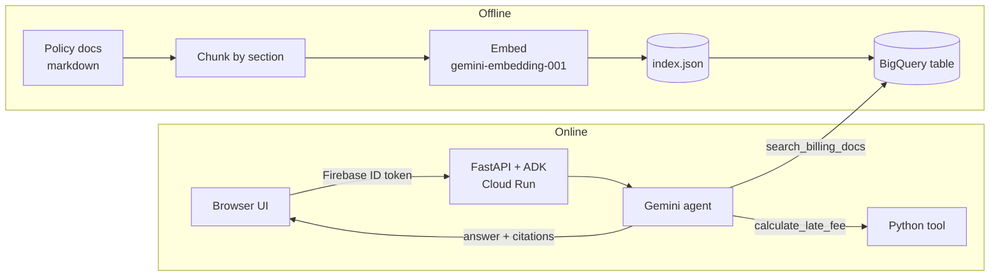

# Billing Assistant Agent

A retrieval-augmented (RAG) customer-support agent that answers mobile billing questions — fees, Auto Pay, disputes, plan changes, taxes and surcharges — with cited answers. Built with Google ADK and Gemini, uses BigQuery vector search for retrieval, and runs on Cloud Run behind Firebase sign-in.

> **Disclaimer:** This is a personal learning project and is not affiliated with, endorsed by, or connected to Verizon. The policy documents in `billing_assistant/docs/` are short summaries of public support pages written for practice; they may be out of date. Always check verizon.com for current terms.

## What it does

- Answers only from the retrieved policy passages and cites the source section of each one.
- Says when it doesn't know: a similarity threshold flags low-confidence retrievals, and the agent declines instead of guessing.
- Uses a tool for arithmetic: late-fee amounts come from `calculate_late_fee`, never from the model.
- Handles messy input, including typos and non-English questions.
- Requires sign-in: every API call needs a verified Firebase ID token, and users can only access their own sessions.

## Architecture



| Piece | File | Notes |
|---|---|---|
| Agent and tools | `billing_assistant/agent.py` | ADK `Agent`, two tools, citation-linking callback |
| Ingestion | `billing_assistant/build_index.py` | One chunk per `##` section; title and section are embedded with the text |
| Vector store | `billing_assistant/load_to_bigquery.py` | Loads `index.json` into BigQuery; search uses `VECTOR_SEARCH` with cosine distance |
| Server | `main.py` | ADK's FastAPI app plus a login middleware and the static UI |
| UI | `static/index.html` | Sign-in form and chat over `/run_sse` (streaming) |

Retrieval has two backends, selected with `VECTOR_BACKEND`:
- `bigquery` (default): vectors live in BigQuery and scale beyond memory.
- `numpy`: in-memory cosine search over `index.json`. It's faster for a small corpus and needs no BigQuery.

## Evaluation

The project has three layers of tests:

| Layer | What it checks | Command |
|---|---|---|
| Unit tests | Late-fee math, including the 5% vs $10 boundary | `pytest billing_assistant/test_tools.py` |
| Retrieval eval | recall@1, recall@3 and MRR over 12 questions, including a misspelled one and a Spanish one | `python -m billing_assistant.retrieval_eval` |
| Agent regression | 8 end-to-end cases with an LLM judge: answer correctness, tool calls, out-of-scope questions, an off-topic request and a jailbreak attempt | `adk eval billing_assistant billing_assistant/billing_regression.evalset.json --config_file_path billing_assistant/test_config.json` |

## Run it locally

Prerequisites: Python 3.13, a Google Cloud project with Vertex AI enabled, and `gcloud auth application-default login`.

```bash
python -m venv .venv && source .venv/bin/activate
pip install -r requirements.txt
```

Create `billing_assistant/.env` (it's gitignored):

```
GOOGLE_GENAI_USE_ENTERPRISE=true
GOOGLE_CLOUD_PROJECT=your-project-id
GOOGLE_CLOUD_LOCATION=us-central1
VECTOR_BACKEND=numpy        # or bigquery
```

Build the index (optional; `index.json` is already committed), then optionally load it into BigQuery:

```bash
python billing_assistant/build_index.py
python billing_assistant/load_to_bigquery.py
```

Start the server:

```bash
python main.py              # http://localhost:8080
```

For quick testing without the UI or login, `adk web` serves ADK's developer UI.

### Sign-in setup

The UI uses Firebase Authentication with email and password. To run your own copy:
1. Create a Firebase project linked to your Google Cloud project and enable the Email/Password provider.
2. Replace the `firebaseConfig` values in `static/index.html` with your project's web config.
3. Turn off self sign-up (Authentication → Settings → User actions) and add users by hand, so strangers can't create accounts that use your quota.

## Deploy to Cloud Run

```bash
gcloud run deploy billing-assistant \
  --source . \
  --region us-central1 \
  --set-env-vars GOOGLE_GENAI_USE_ENTERPRISE=true,GOOGLE_CLOUD_PROJECT=your-project-id,GOOGLE_CLOUD_LOCATION=us-central1,VECTOR_BACKEND=bigquery
```

The service account needs the Vertex AI User, BigQuery Job User and BigQuery Data Viewer roles. `.gcloudignore` keeps `.env`, local ADK state and test files out of the upload.

## Project structure

```
├── main.py                       # FastAPI + ADK app, auth middleware, static UI
├── Dockerfile
├── requirements.txt
├── static/index.html             # chat UI
└── billing_assistant/
    ├── agent.py                  # agent, tools, retrieval
    ├── build_index.py            # chunk + embed docs -> index.json
    ├── load_to_bigquery.py       # index.json -> BigQuery
    ├── index.json                # prebuilt embeddings
    ├── docs/                     # policy summaries (knowledge base)
    ├── retrieval_eval.py
    ├── test_tools.py
    ├── billing_regression.evalset.json
    └── test_config.json
```

## License

MIT
